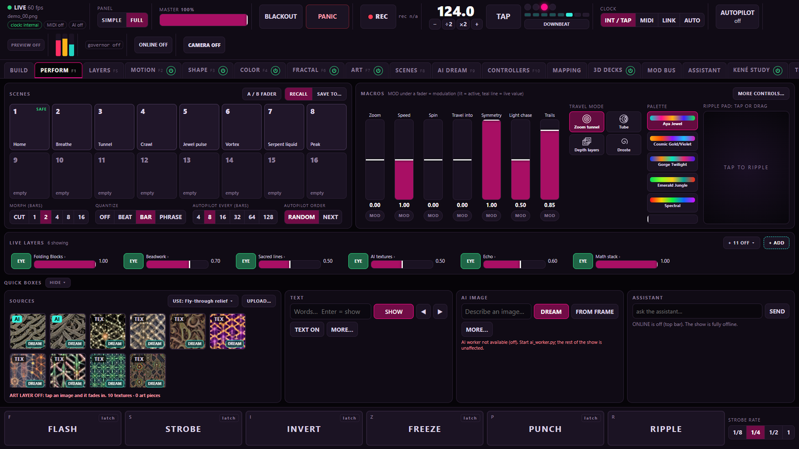
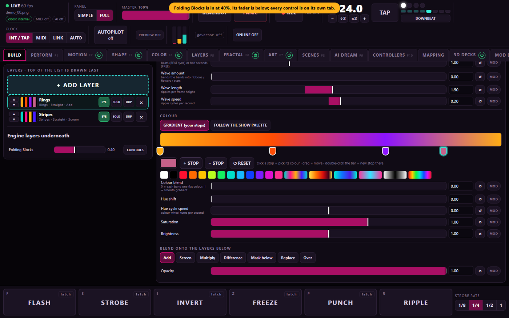
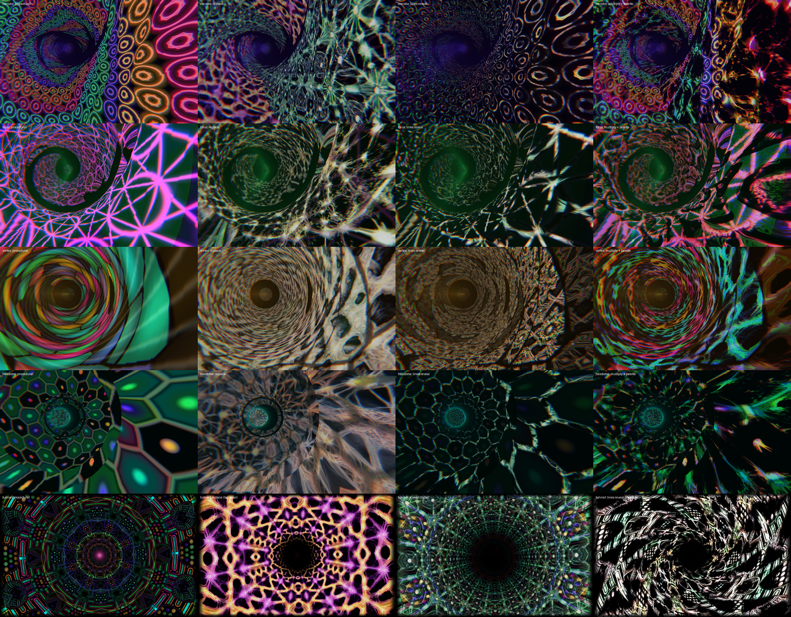

# EntheoControl reference manual

Everything you can set, press and launch, in one place. New here? Do the guided [WALKTHROUGH.md](WALKTHROUGH.md) first, then keep this open as a reference. Before a real gig, print [docs/SHOW_DAY_CHECKLIST.md](docs/SHOW_DAY_CHECKLIST.md).

All commands run in PowerShell from the project folder:
```powershell
cd C:\path\to\EntheoControl
```
`python` below means the project's own venv: `.\.venv\Scripts\python.exe`.

**Contents**
1. [Setup](#1-setup)
2. [Launching](#2-launching)
3. [The panel, tab by tab](#3-the-panel-tab-by-tab)
4. [Keyboard](#4-keyboard)
5. [Layers reference](#5-layers-reference)
6. [Modulation, clock, scenes, autopilot](#6-modulation-clock-scenes-autopilot)
7. [Controllers: MIDI, cue channel, gamepad](#7-controllers-midi-cue-channel-gamepad)
8. [Mapping](#8-mapping)
9. [Crowd camera](#9-crowd-camera)
10. [Recording](#10-recording)
11. [Shows, presets, timeline](#11-shows-presets-timeline)
12. [AI: local and online](#12-ai-local-and-online)
13. [Safety](#13-safety)
14. [Troubleshooting](#14-troubleshooting)
15. [File locations](#15-file-locations)
16. [Other tools](#16-other-tools)
17. [Coming next](#17-coming-next)
18. [Glossary](#18-glossary)

---

## 1. Setup

### 1.1 The projector
1. Connect HDMI from the laptop to the projector and power it on. Dark room, projector square to the wall. A short-throw projector needs about 1-2 m; a standard one needs more.
2. Press **Win + P** and choose **Extend** (not Duplicate). The projector becomes display 2, which is monitor index **1** for the engine.
3. In the projector's own menu, turn **Auto Keystone OFF** and set keystone to 0. All warping happens in software, which keeps the picture sharp.
4. Windows **Settings > System > Display**: set the projector to its **native resolution** (1280 x 800 on the test projector) and scaling to 100 %.
5. Focus and square it with the test pattern: `python test_pattern.py --monitor 1` (Esc or Q closes it). Circles should be round, the border rectangular, the 1-pixel line pairs in the corners sharp.

If your projector's native resolution is not 1280 x 800, pass `--render WxH` with its native size (see [2.2](#22-engine-flags-live_visualspy)).

### 1.2 Windows settings for shows (power and heat)
A heavy show can draw more than a laptop's stock charger delivers, and a hot GPU throttles. These settings make the biggest difference. The panel lists them too: **CONTROLLERS > Health > Power > Windows power checklist**.

| Setting | Where | Value | Why |
|---|---|---|---|
| Charger | the wall socket | The laptop's **stock charger** (or a higher-watt one), plugged in directly, **not** through a dock or USB-C hub | Docks and hubs often deliver less power |
| Maximum processor state | Control Panel > Power Options > Change plan settings > Advanced > Processor power management | **99 %** on AC | Turns CPU turbo off: a large power and heat saving, no visible cost |
| Max Frame Rate | NVIDIA Control Panel > Manage 3D settings > Program settings > `python.exe` | **60** (or the show's cap) | No wasted frames |
| WhisperMode | NVIDIA Control Panel or GeForce app, for `python.exe` | **Off** | It fights the show's own frame pacing |
| Threaded optimization | NVIDIA Control Panel > Program settings > `python.exe` | **Off** | Avoids a busy-spin on vsync |
| Preferred graphics processor | NVIDIA Control Panel (or Windows Graphics settings) for `python.exe` | **High-performance NVIDIA** | The engine must not land on integrated graphics |

Also: raise the back of the laptop so the vents breathe, close heavy apps, and turn off notifications (Focus / Do not disturb) so nothing pops up on the projector.

### 1.3 Audio
The engine listens to whatever the laptop is playing (WASAPI loopback) by default: Spotify, a browser, a DJ app. For a DJ's line-out, use a USB audio interface and play it through the laptop, or use `--audio mic` to listen to the room microphone. The three meters in the top bar (bass, mid, high) show what it hears.

### 1.4 Phone or tablet as the panel (optional)
The panel is a web page. The console prints a URL like `http://<laptop-ip>:8765/?k=<token>` (plus a QR code if `qrcode` is installed). Open it on a phone or tablet on the same Wi-Fi.
- The first time, Windows asks whether to allow Python through the firewall: tick **Private networks**. Make sure the Wi-Fi connection itself is set to the Private profile.
- Venue Wi-Fi often isolates devices from each other. Use your phone's hotspot instead and join the laptop to it (no internet needed). Press **Ctrl+W** twice in the projector window to reprint the URL with the new address.
- The token is stored in `.remote_token` and survives restarts, so an open panel reconnects by itself.

---

## 2. Launching

### 2.1 run_show.ps1 (the normal way)
```powershell
powershell -ExecutionPolicy Bypass -File run_show.ps1
```
With no arguments it runs `live_visuals.py --monitor 1 --panel`. Any arguments you add **replace** those defaults and are passed to the engine, so include `--monitor 1 --panel` yourself:
```powershell
.\run_show.ps1 --monitor 1 --panel --spout
.\run_show.ps1 --monitor 1 --panel --fresh          # start on a clean canvas, panel in SIMPLE mode
.\run_show.ps1 --monitor 1 --panel --audio mic
```
What it does:
- Starts the **AI worker** (`ai_worker.py`) as a separate low-priority process. Skip it with `$env:NO_AI = '1'` before launching.
- Starts the engine and writes its log to `logs\show_<time>.log` (AI worker: `logs\ai_<time>.log`).
- **Watchdog**: a clean quit (Shift+Esc, exit code 0) ends the show. A crash restarts it within about 1 s, and the controller restores the last live state (`live_state.json`), so the look carries on. On a restart it drops `--panel` (the open panel reconnects by itself) and `--fresh` (so a restart resumes what you were building). Five crashes within 60 s stop the loop.
- Stops the AI worker when the show ends.

### 2.2 Engine flags (live_visuals.py)
`python live_visuals.py --help` prints these.

**Show**
| Flag | Default | What it does |
|---|---|---|
| `--monitor N` | none (preview window) | Borderless full screen on monitor N (projector usually 1). Waits for it if it is unplugged. |
| `--panel` | off | Open the control panel in a browser on this laptop (implies `--remote`) |
| `--remote` | off | Start the panel web server (Ctrl+W toggles it at runtime) |
| `--remote-port P` | 8765 | Panel port |
| `--remote-token T` | stored in `.remote_token` | Panel token |
| `--render WxH` | 1280x800 | Internal render size: set it to your projector's native resolution |
| `--audio loopback\|mic\|none` | loopback | What the visuals listen to |
| `--spout` | off | Also send the picture to TouchDesigner / Resolume over Spout (sender `PsyProjector`) |
| `--fresh` | off | Start on a clean black canvas with one moving stripe layer and open the panel in SIMPLE mode. RESTORE PREVIOUS brings back the saved look. |
| `--governor off\|suggest\|auto` | saved setting, else suggest | Resource governor mode |
| `--skin-size 512\|1024` | 512 | Resolution of the skin texture array (11 MB or 43 MB of VRAM) |
| `--limit-mean X` | built-in | Brightness ceiling: the mean level 0..1 the frame may reach |
| `--record [SECONDS]` | off | Start recording at launch, optionally stop after SECONDS |
| `--record-opts K=V,...` | panel settings | `source=program\|projector`, `fps=30\|60`, `res=native\|1080p`, `audio=off\|laptop\|mic`, `quality=draft\|standard\|high` |
| `--record-dir DIR` | `recordings\` | Where recordings go |

**Content folders and starting look**
| Flag | Default | What it does |
|---|---|---|
| `--textures DIR` | `textures\` | AI texture library |
| `--videos DIR` | `videos\` | Video loops for the video layer |
| `--art DIR` | `art\` | Uploaded art pieces |
| `--cycle S` | 12 | Legacy: seconds per AI texture. The panel's **Image hold** fader (LAYERS) now sets this. |
| `--mode PRESET` | | Starting layer preset: `kene` (Folding Blocks), `kene+beads`, `beads`, `ai`, `both`, `lines`, `all` |
| `--palette P` | | Starting palette 0..4 (fractional = blend) |
| `--folds N` | | Starting fold count: 3, 4, 5, 6, 8, 10, 12, 16 or 24 |
| `--fb X` | | Starting trails amount 0..0.98 |
| `--twist I` | | Starting twirl preset 0..3 |
| `--set NAME=VALUE` | | Set any `params.py` value at start (repeatable) |

**Headless checks (no window, for testing)**
| Flag | What it does |
|---|---|
| `--test N` | Render N frames, save samples to `test_frames\`, print fps and frame health |
| `--gallery` | Render every look, contortion, trigger and travel mode into `test_frames\gallery\contact_sheet.png` |
| `--batch JOBS.json` | Render a list of jobs `[{name, sets, frames, script}]` in one process |
| `--out DIR`, `--snapshot` | Output folder; also write `snapshots\current.png` at the end |
| `--extreme min\|max\|randN` | Stress test: every param at its min, max or a seeded random mix |
| `--test-audio beat\|silent`, `--test-fps N`, `--pace` | Synthetic audio; show-time frame rate; pace frames in real time (power tests) |
| `--phase-offset K` | Add K whole wrap periods to every phase (the picture must not change) |
| `--no-nan-guard` | Shader outputs raw values (tests) |
| `--live-controller` | Use the real controller instead of the static one |
| `--text TEXT` | Words for the text layer (`\|` = new line) |
| `--stack FILE.json`, `--skins FILE.json`, `--surfaces FILE.json` | Load a math stack, skins or a surfaces file (read-only) |
| `--flashguard` | Run the flash guard in a headless run too (a show always runs it) |

### 2.3 Quitting and unplugging
- **Quit:** **Shift+Esc**, or Esc twice within 1 s, in the projector window. A single Esc never ends a show. Closing the window needs the same confirmation. (In the preview window a single Esc quits.)
- **Projector missing at launch:** with `--monitor N` the engine waits, retrying every 2 s, instead of opening a preview window.
- **Projector unplugged mid-show:** the window is parked and rendering pauses until it is back.
- **Mouse cursor:** hidden over the projection except while calibrating.

### 2.4 The panel without a projector
`python remote_control.py --port 8799` serves the real control system with fake audio and no engine, for learning the panel or testing a controller. Add `--midi` to open MIDI ports, or `--fresh` for a clean canvas.

---

## 3. The panel, tab by tab



### 3.1 Everywhere
**Top bar**
| Control | What it does |
|---|---|
| Status | LIVE / connecting, fps, the texture on show, pills for clock, MIDI and AI |
| SIMPLE / FULL | SIMPLE shows only BUILD, PERFORM and SCENES (plus the top bar and trigger row). Remembered per browser. |
| Master | Overall brightness |
| BLACKOUT | Hold for black (about 100 ms fade) |
| PANIC | Hold 0.5 s (or hold Esc): jump to the SAFE scene, clear every trigger, stop the timeline. See [13.1](#131-panic). |
| REC | Start / stop recording; shows elapsed time and size |
| BPM, −, ÷2, ×2, + | Tempo. Mouse wheel nudges it (Shift = fine). |
| TAP | Tap tempo (last 4 taps; resets after 2 s) |
| Beat and bar lights, DOWNBEAT | DOWNBEAT makes "now" beat 1 of the phrase |
| Clock: INT / TAP, MIDI, LINK, AUTO | Clock source (see [6.2](#62-clock)) |
| AUTOPILOT | Scene autopilot on / off |
| Output monitor + PREVIEW | **PREVIEW is OFF by default** to save the GPU. ON shows a small live picture (click for a large one) and enables SOLO and layer thumbnails. Remembered per browser. |
| Meters | Bass, mid, high |
| Health meter | Resource governor state, fps, GPU, temperature, battery. Click it for the Health card. |
| FLASH GUARD | Green while idle, amber "HOLDING" while it limits flashes, red "FLASH GUARD OFF" while overridden |
| ONLINE | OFF by default. See [12.3](#123-online-assistant-and-gemini-images). |
| CAMERA | Shows CAMERA OFF; turns into a red blinking CAMERA ON while the webcam is in use. Click to switch it off. |

**Tab strip**: the tabs (power icons on the ones that change the picture), **SHOW** and **PRESETS** (see [11](#11-shows-presets-timeline)), **ALL FX**, **MIDI LEARN** and **?** (keyboard sheet plus the AGPL source link).

**Trigger row (bottom)**: FLASH, STROBE, INVERT, FREEZE, PUNCH (hold = momentary, the small "latch" corner = stays on), RIPPLE, and the **Strobe rate** (1/8, 1/4, 1/2, 1).

**Faders**: drag = set, Shift-drag = fine, wheel = nudge, double-click = default. **MOD** opens the modulation editor; a lit MOD means the fader is modulated and a teal line shows the live value.

**Power buttons (bypass)**: every tab that changes the picture has a power icon on its tab button and a big ON / OFF switch at its top. A layer's **EYE** does the same for one layer. **ALL FX** switches every effect (not the layers) off. Off fades out (0.3 s by default) and on comes back to exactly the same settings, because faders, mods and scenes are never edited. Bypass survives a restart. Scenes neither store nor change it, and PANIC leaves it alone, except that PANIC clears a bypass of the whole LAYERS tab, which would mean a black wall. MAPPING, PERFORM, SCENES, AI DREAM, CONTROLLERS and MOD BUS have no power button.

### 3.2 BUILD
Start simple and build up. 
- **NEW CANVAS**: crossfades to black with one moving stripe layer (every engine layer bypassed, autopilot off). **RESTORE PREVIOUS** brings back the look from before, exactly. Both survive a restart.
- **UNDO** (40 steps, per browser) and the stack amount fader.
- **+ ADD LAYER**: Stripes, Rings, Spiral, Rays, Checker, Waves, Polygons, Noise bands (up to 8). Further down, "bring in from the engine": Folding Blocks, Beadwork, Sacred lines, Beings, Math fractals, Art, 3D landscapes, Text, AI textures, Video, and the two study layers. Bringing one in switches its bypass off and sets its fader to 0.4.
- **The pile** (top = drawn last): up / down, EYE, SOLO, DUP, delete (click twice). Below it, a fader and CONTROLS link for each engine layer that is showing.
- **Layer details** (right): every number has a fader, a typed box, a reset and MOD, and is MIDI-learnable.
  - Shape: how many bands, band width, edge softness, waveform (Sine, Square, Triangle, Saw).
  - Space: Straight, Polar, Tunnel, Kaleidoscope, Mirror X / Y / XY, Floor; angle, zoom, centre.
  - Motion: scroll speed (FREE = per second, BEAT = per beat), spin, pulse, wave amount / length / speed.
  - Colour: a gradient of 2-6 stops (click a stop = colour picker, drag = move, **+ STOP** / **− STOP**, RESET, swatches, presets) or FOLLOW THE SHOW PALETTE; Colour blend, hue shift, hue cycle speed, saturation, brightness.
  - Blend onto the layers below: Add, Screen, Multiply, Difference, Mask below, Replace, Over; Opacity.
- A scene saved now stores the stack and morphs it on recall.
- Safety: very wide bands cannot scroll faster than 2.5 per second, pulses never beat faster than 2.5 Hz, and brightness changes are slewed. The panel says "speed limited" when this holds a layer back.

### 3.3 PERFORM (one screen)
Fits a 1920 x 1080 screen without scrolling. On a phone or tablet it stacks.
- **Scenes**: the 16 pads with thumbnails. RECALL / SAVE TO…; morph (CUT, 1-16 bars), quantize (OFF, BEAT, BAR, PHRASE), autopilot period (4-128 bars) and order (RANDOM, NEXT). **A / B FADER** opens the scene crossfader. A compact **timeline strip** (play, stop, rec, position, RE-ENABLE, TIMELINE >) sits in the header.
- **Macros**: Zoom, Speed, Spin, Travel into, Symmetry, Light chase, Trails; travel mode tiles; palette swatches; a ripple pad. **MORE CONTROLS…** opens a drawer with rotate, swim, hue, saturation, folds, density, twirl, bulge, wave, ripple, chase width / rate / mode and serpent mode.
- **Live layers**: one row (EYE + fader) per layer that is showing; tap a name to open its tab. **+ N OFF** lists the others (tap one to bring it in). **+ ADD** opens BUILD.
- **Quick boxes** (HIDE / SHOW): Sources thumbnails with use modes and UPLOAD…, a text box (SHOW, TEXT ON), an AI image box (DREAM, FROM FRAME), and the assistant box.
- Esc closes a drawer; holding Esc still reaches PANIC.

### 3.4 LAYERS
- **Layers card**: one row per layer with EYE (on the projector, settings kept), SOLO (the panel's monitor only, needs PREVIEW on), a live thumbnail (PREVIEW on, LAYERS tab only) and an opacity fader. **SOLO OFF** and **SHOW ALL HIDDEN** reset them. The card's monitor says LIVE OUTPUT or PREVIEW ONLY.
- **Video loops**: video layer and luma key.
- Image cycling: **Cycle images** (Hold by default, or Cycle) and **Image hold (s)** (default 60 s) for AI textures.
- All layer faders. See [5](#5-layers-reference).

### 3.5 MOTION
Beings (first card), travel and serpents, the **Spin** card (roll the tunnel / fly-through), and the **SKINS** card for the travel tunnel.

### 3.6 SHAPE
Zoom, pan (an XY drag pad), rotate speed, symmetry, folds, speed, crawl / flow and crawl angle; swim, twirl, bulge / pinch, wave, density; ripple strength and decay with a **ripple pad** (tap or drag).

### 3.7 COLOR
Palette (fractional values blend two palettes), hue shift, saturation, light chase (amount, width, rate, mode: single, dual, counter) and trails. **Colour narrative**: palette glide (OFF, 1-32 bars), so every palette change slews that long.

Palettes: Aya Jewel, Cosmic Gold/Violet, Gorge Twilight, Emerald Jungle, Spectral.

### 3.8 FRACTAL
Fractal mode (KIFS, Mandelbox, hyperbolic, Apollonian, Julia, 4D polytope), morph, detail, glow, iridescence, render scale. Raise **Math fractals** (`l_fractal`) to see it.

### 3.9 ART
- **Art library**: drop images (PNG / JPEG / WebP, up to 25 MB each) or click to choose. A depth map is made by the AI worker. ◀ PREV / NEXT ▶ step through pieces.
- **Sources**: uploaded art and AI images; click = use it now. If the art layer was at 0 it fades in (a red line says "THE ART LAYER IS OFF" while it is). Each thumbnail has a small **DREAM** button (see [12.2](#122-dreamify)).
- **Art use** (big buttons): Fly-through relief, Inside the lines (stencil), Kaleidoscope, Tunnel walls, Displace pattern, Full frame melt. **Image source**: uploaded art or the AI texture on show.
- **Fly pad**: drag to fly yaw / pitch; HOLD POSITION. Faders: relief depth, yaw, pitch, roll, fly in / out, camera drift, melt, liquify, depth slices, breathe, kaleido fold, Droste, slit-scan smear, edge glow. Melt, liquify, slices and smear share a budget, so stacking several scales them down together.

### 3.10 SCENES
- **Scenes**: 16 slots. Mode buttons: RECALL, SAVE TO…, CLEAR…, SET SAFE… (the scene PANIC jumps to, marked SAFE; slot 1 by default), DECK A…, DECK B…. Click = recall at the next quantize boundary with a morph; Shift-click or long-press = save; Alt-click = recall now. Slots 1-8 start as factory looks (Home, Breathe, Tunnel, Crawl, Jewel pulse, Vortex, Serpent liquid, Peak).
- **Transition**: morph length and quantize.
- **Autopilot**: Scene change ON / OFF, every 4-128 bars, order, hold palette family (0-16 phrases), drift (a slow random walk) with amount and a chip list of drifting params.
- **Scene crossfader**: pick DECK A and DECK B, then drag to blend two scenes by hand (continuous faders blend, stepped ones flip at the middle).
- **Transition** (same card as Morph and Quantize): the visual transition recalls use, with its beats, style, origin pad, END NOW / CANCEL, and SET FOR A SCENE… / the TRANSITION… scene mode. See [6.3b](#63b-transitions-doors-iris-portal-).

### 3.11 AI DREAM
Prompt (Enter = generate, Shift+Enter = new line), negative prompt, count (1, 2, 4, 8), seed, SHOW WHEN READY, **GENERATE**, CANCEL QUEUE, **DREAM FROM CURRENT FRAME** with a strength fader (low = stay close to the frame), prompt presets, Results, Prompt history. With ONLINE on, an **Image engine** selector and the Gemini key row appear above the prompt. See [12](#12-ai-local-and-online).

### 3.12 CONTROLLERS
- **Devices + clock**: MIDI input ports, last message, clock source, MIDI clock port, **cue channel** (OFF or 1-16) and its CC table.
- **Bindings**: the MIDI map; RESTORE DEFAULT MAP, CLEAR ALL BINDINGS (tap twice), ✕ per binding.
- **Gamepad**: assign sticks, triggers and buttons (saved in that browser).
- **Record**: see [10](#10-recording).
- **Health (resource governor)** and **Power**: see [13.4](#134-resource-governor) and [13.5](#135-power-balance).
- **Flash guard**: see [13.2](#132-flash-guard).

### 3.13 MAPPING
Surfaces list, the projector canvas, the selected surface's controls, and the **AUTO MAP** card. See [8](#8-mapping).

### 3.14 3D DECKS
- **Deck mixer**: Deck A, Deck B (Sacred corridor, Torus wormhole, Prismatic vortex, Hex domes), A / B crossfade, A / B blend (eight modes), A warps B, twist, curvature, geo morph, field of view, camera, torus glass, fold invert, prism split, render scale. **WARP JUMP + SHOCKWAVE** fires a punch.
- **Particle swarm**: vortex, turbulence, ribbon trails, gold tint.
- **SKINS** card for the four worlds (see [5.4](#54-skins)).
- Raise **3D landscapes** (`l_land`) and **Particle swarm** (`l_swarm`) to see them.

### 3.15 MOD BUS
- **Audio in**: a live scope of bass, mid and high.
- **Step sequencer**: 16 steps feeding the mod sources SEQ (step value) and GATE (pulse on gated steps); RANDOMIZE.
- **Active modulation**: every modulated fader in one list.
- **Mod sources**: the crowd camera sources, live.

### 3.16 ASSISTANT
The online assistant (OFF unless ONLINE is on). See [12.3](#123-online-assistant-and-gemini-images).

### 3.17 TIMELINE
See [11.3](#113-timeline).

### 3.18 KENÉ STUDY
The two generative study layers (off by default) with their credit card and **NEW DESIGN**. See [5.5](#55-kené-and-bead-studies).

### 3.19 TEXT
- **Text**: the words on show, SHOW, TEXT ON.
- **Words** and **Phrases (lyrics / mantras)**: a phrase list with ◀ PREV, NEXT ▶ and AUTO-CYCLE (every beat or bar).
- **Font**: any font installed in Windows, the per-user font folder or `fonts\`.
- Faders: size, position, letter and line spacing, tilt, colour mode (Show palette, Fixed colour, Rainbow letters, Light chase), hue, colour depth, fill, outline, glow, **Movement** (Static, Drift, Orbit ring, Marquee, Letter wave, Tunnel spiral, Beat bounce), movement speed and amount, audio pulse, **Integration** (Overlay, Woven, Stencil mask, Knockout, Displace, Rides the scene, Kaleidoscope, Echo trails), weave, dissolve.

### 3.20 FILTERS
- The chain: up to 6 filters, top runs first. ▲ / ▼ reorder, ✕ takes one out (its settings stay). **+ ADD FILTER**: Deep dream, Oil paint, Halftone, Neon edges, Prism split, Posterize, Pixel sort, Glitch, Bloom, Mirror / kaleido. **RESET CHAIN** (tap twice).
- A filter whose amount is 0 does not run ("AMOUNT 0: NOT RUNNING"). Filters not in the chain are in "All filter params" at the bottom.
- With no filter running the pass is skipped entirely: zero cost.
- Glitch never fires more than 2.5 times a second and every glitch ramps in and out.

### 3.21 CAMERA
See [9](#9-crowd-camera).

---

## 4. Keyboard

### 4.1 Panel keys (press `?` for the sheet)
| Key | Does |
|---|---|
| Space | Tap tempo |
| Enter | Downbeat (resync the phrase) |
| `-` / `=` | BPM −1 / +1 |
| `A` | Autopilot on / off |
| `1`…`0` | Recall scene 1-10 (Ctrl = 11-16); Shift = save |
| `B` (hold) | Blackout |
| Esc (hold 0.5 s) | PANIC. A tap closes the drawer, editor or sheet that is open. |
| `F` `S` `I` `Z` `P` (hold) | Flash, Strobe, Invert, Freeze, Punch |
| `R` | Ripple from the centre |
| F1…F10 | Tabs (the number is printed on each tab; BUILD has none) |
| `L` | MIDI learn mode |
| `N` / `V` / `[` `]` | Next texture / next video clip / previous, next art piece |
| Ctrl+S | Save the show |
| `?` | Keyboard sheet |

In learn mode, right-click a control to forget its bindings.

### 4.2 Projector-window keys
Click the projector window first. The panel is usually easier.
| Area | Keys |
|---|---|
| Looks | `M` layer preset · `P` next palette (4 s glide) · `1`-`9` fold count · TAB flat field / mandala · `T` twirl · `F` echo on / off · Up / Down trails · Space next AI texture · `V` next video clip |
| Space | `-` / `=` zoom · `[` / `]` density · Left / Right crawl speed · `A` / `D` crawl angle · `O` / `L` bulge / pinch · `U` wave · `N` travel mode · `H` / `Y` travel slower / faster · `E` serpents on / off |
| Hold | `X` flash · `Z` strobe · `I` invert · `Q` freeze · `K` blackout · `J` zoom punch |
| Tempo | `,` or `.` tap |
| Mouse | click = ripple at that point (when not calibrating) |
| Mapping | Ctrl+C calibrate (drag the nearest corner of any surface) · `S` save mapping · Ctrl+G outlines + grid + names · while calibrating: Ctrl+Z undo, Ctrl+R reset the selected surface to full frame |
| Recording | Ctrl+R start / stop (when **not** calibrating) |
| Guarded | Ctrl+Backspace reset space, shape and motion to defaults · Ctrl+W panel server on / off |
| Quit | Shift+Esc, or Esc twice within 1 s |

Note the trigger keys differ between the panel (`F S I Z P`, `B`) and the projector window (`X Z I Q J`, `K`).

---

## 5. Layers reference

Every layer has an opacity fader on LAYERS (and in PERFORM's live layers when it is up) and a power switch (EYE). A layer at 0 costs nothing: its pass is not rendered.

### 5.1 Engine layers
| Layer (fader) | Default | Main controls | Tab |
|---|---|---|---|
| Folding Blocks (`l_kene`) | on | symmetry, folds, density, flow, crawl angle | SHAPE |
| Beadwork (`l_beads`) | on | folds, density | SHAPE |
| Sacred lines (`l_lines`) | on | folds, density | SHAPE |
| AI textures (`l_ai`) | on | Cycle images, Image hold, AI DREAM | LAYERS, AI DREAM |
| Echo (`l_echo`) | on | trails, Echo fader | COLOR, LAYERS |
| Video loops (`l_video`) | off | luma key, `V` next clip; loops go in `videos\` | LAYERS |
| Math fractals (`l_fractal`) | off | fractal mode, morph, detail, glow, iridescence, render scale | FRACTAL |
| Art pieces (`l_art`) | off | art use, image source, fly pad, distortions | ART |
| 3D landscapes (`l_land`) | off | deck A / B, crossfade, blend, camera | 3D DECKS |
| Particle swarm (`l_swarm`) | off | vortex, turbulence, trails, tint | 3D DECKS |
| Beings (`l_beings`) | off | being, how many, size, speed, wiggle, glow, ornament, variety, colour mode | MOTION |
| Serpents (`serpent`) | off | serpent mode (serpents, warp, both), count, segments, slither speed, wiggle, size, colours | MOTION |
| Text (`l_text`) | off | see [3.19](#319-text) | TEXT |
| Math stack (`l_stack`) | on (the stack is empty by default) | the BUILD tab | BUILD |
| Crowd camera (`l_camera`) | off | see [9](#9-crowd-camera) | CAMERA |
| Kené study (`l_kene_shipibo`), Bead study (`l_kene_hunikuin`) | off | see [5.5](#55-kené-and-bead-studies) | KENÉ STUDY |

**Topology**: Symmetry 0 is a flat field tiling the whole frame and crawling along Crawl / flow; 1 is an N-fold mandala; in between cross-fades.

**Travel modes** (Travel mode, then push Travel into): 0 Zoom tunnel, 1 Tube (mandala) or ground and sky planes (flat), 2 Depth layers, 3 Droste spiral. Tunnel bend and Depth fade shape it; **Spin** barrel-rolls and **Spin twist** makes the far end lead.

### 5.2 Beings
18 forms (`being`): Anaconda spirit, Feathered dragon, Jaguar spirit, Hummingbird, Butterflies & moths, Jellyfish, Manta rays, Koi, Firebird, All-seeing eyes, Light beings, Jester sprites, Octopus, Spirit vine, Fireflies, Whale, Kittens, Sprite (your image). **Variety** 0 = all the chosen form, 1 = every being a different form. **Colour mode** (beings and serpents separately): Show palette, Single hue, Two-tone, Rainbow, Each its own hue, Light chase. Bass pulses them, highs sparkle. All are generated archetypes, not copies of any artwork.

**Sprite (your image)** (being 17) animates a picture YOU supply. Your images stay on this laptop in `art/` and are never part of the repository; use only artwork you have the rights to.
1. Put the image in `art/` (ART tab upload). A PNG with transparency works best: its outline becomes the creature's outline exactly. A JPG or a picture without transparency is keyed on its border colour (a plain background works).
2. Several poses: name them `walk_1.png`, `walk_2.png`, ... (up to 8, numbered) and pick any one of them, or put up to 8 poses side by side in one image and set **Poses in a sheet** to the number of poses.
3. BEINGS tab: switch **SKINS ON** on the "SPRITE CREATURE" card and drop your image (from any Sources picker) on the **SPRITE** tile. Set **Being** to "Sprite (your image)" and raise the Beings layer. Until you pick an image a generic stand-in figure dances.
- **Dance**: Free dance, March in a line (one hop per beat), Conga line (a kick on beat 4), Mirror pairs (partners face each other), Bounce in place, Flock. **Bounce** = hop height + squash / stretch. **Spins** = how often one spins round. They face the way they walk; **Image faces** tells it which way your picture looks (or Never flip).
- **Pose step**: every beat / half-beat / bar / two beats; **Pose crossfade** morphs one outline into the next.
- **Sprite look**: Image (its own colours; **Sprite tint** blends in the colour mode), Glowing outline, Solid silhouette (colour modes: rainbow, each its own hue, light chase...), Skinned fill (drop any image or live layer, e.g. the kené study, on the **FILL** tile).
- SVG drawings need the optional `cairosvg` package (not installed); export a PNG instead.

### 5.3 3D decks
Four raymarched worlds (Sacred corridor, Torus wormhole, Prismatic vortex, Hex domes) on an A / B deck. Blend modes and "A warps B" combine them. Their colours come from the show palette, and folds, hue, travel, punch and the fly camera act on them.

### 5.4 Skins
Put any library image (uploaded art, an AI texture, a dreamified picture) on the surfaces of a world. 
1. **Skins are OFF by default.** Press **SKINS: OFF** in a SKINS card to switch them on (remembered across restarts). While off nothing is loaded and nothing costs anything.
2. **Slots**: 3D DECKS > SKINS: Sacred corridor (walls, floor), Torus wormhole (tube, chambers), Prismatic vortex (walls), Hex domes (domes). MOTION > SKINS: the travel tunnel (walls). A skin belongs to the world, whichever deck shows it.
3. **Assign**: drag a thumbnail from any Sources picker (or the card's strip) onto a slot. On a touch screen: tap the slot, then an image. **PROCEDURAL** goes back to the built-in look (settings kept).
4. **Shape it**: Mapping (Surface, Triplanar, Screen; the tunnel has Follow the travel mode, Log-polar, Tube, Screen), Mix (Replace, Multiply, Screen, Overlay, Lines reveal the skin), Tiling (Mirror = seamless with any picture, Repeat = for AI textures that already tile), Amount, Scale, Rotation, Scroll speed and direction (Free or On the beat), Follow the show palette, Brightness, Tint.
5. **GENERATE A SKIN**: type a prompt; the local AI worker makes a seamless tile when it has nothing else to do and it lands on the selected slot.
6. Every skin fader has MOD and is MIDI-learnable. Skins are saved with scenes, look presets and shows. PANIC puts every slot back to procedural.

Cost: a world with no skin costs exactly what it did before; a skin is one texture fetch per pixel, Triplanar three. Memory: up to 8 skins (512 px, about 11 MB; `--skin-size 1024` about 43 MB). Under strain the governor drops to 512 px, and at its last step skins fade to procedural until it recovers. Images are squashed to a square, so a photo of a face looks stretched; patterns are fine.

<!-- TODO(skins): Beings bodies and the Folding Blocks fill are not skinnable yet. Document here when the skins fixes land. -->

### 5.5 Kené and bead studies
Two generative study layers of the visual grammar documented in [research/kene_reference/README.md](research/kene_reference/README.md). They copy no artwork and must never be called authentic kené. Raise them on LAYERS, or via BUILD > + ADD LAYER.
- **Kené study (Shipibo-Konibo inspired)**: Medium (Light on black, Mud-dyed cloth, Embroidery, Ceramic, Beadwork), Colours, **Field** (Single panel, Panels, Band, Medallion, Follow the show), Design 1-32 and **NEW DESIGN**, line density, straight / curving, line weight, fine fill, Drawn, **Pen** (draw the design in over 4-32 bars, optionally a new design each time), flowing light, breathing, glow, follow light chase.
- **Bead study (Huni Kuin inspired)**: bead motif (study), bead medium (Glass beads, Woven, Painted), bead colours, motif morph, bead count, beads light in sequence, bead glow.
- For a box face or a strip, use Field = Single panel or Band: they stay still and fill the surface cleanly.
- Credit for public shows: "Generative study inspired by Shipibo-Konibo kené / Huni Kuin kenê kuin. For public shows, credit and collaborate with the originating communities. See research/kene_reference."

### 5.6 Coil nest (serpent bodies)
A frame-filling nest of 6 to 14 thick serpent bodies: no room and no sky. The bodies are the architecture, with pitch-black crevices between them. Textile-like kené-type skins slide along each body, neighbours in opposite directions, while the bodies slowly writhe and the camera breathes in and out. Inspired by the grammar of TAS Visuals' "Serpents" (2016); nothing of that piece is copied. Raise **Coil nest (serpent bodies)** on LAYERS; the **COILNEST** tab holds the rest. Off by default, and off costs nothing.
- **Bodies** 6-14, **Thickness**, **Writhe / breathe**, **Skin slither**, **Camera breathing**, **Heads** (none = endless coils), **End caps** (medallion caps on the bodies that rise toward you).
- **Gating**: every skin has four channels: primary lines, fine fill, cloth ground and jewel accents. With **Gating programme on the bar**, it walks Linework only, White engraving, Floating ground patches, Full embroidered cloth, Rim sweep, changing every 2 / 4 / 8 / 16 bars (**Bars per stage**). Changes are always slow fades (at least half a second), so no flicker. **Manual stage** lets the timeline, clips or a MIDI pad choose the **Stage**. **Gating depth** 0 = always the full cloth. **Primary lines / Fine fill / Cloth ground / Jewel accents / Rim sweep** scale each channel on top.
- **Skin source**: Procedural kené (default); **SKINS slot** (switch SKINS on and drop an image or an AI texture on "Coil nest bodies": it becomes the cloth, and the lines stay on top); **Kené study channels** (the 4-channel line layer); **Engine layer** (pick one under **Layer as skin**: kené study, beads, Folding Blocks, beings, math stack, fractals, text, camera, video, filtered output).
- **Follow show palette**, **Line glow**, **Black crevices** (1 = the nest hides everything under it, 0 = other layers show through the gaps), **Render scale** (the governor lowers it, and halves the body count, under load).
- **Serpent skin (coil nest)** on MOTION dresses the classic serpents in the same skin and gating, even with the coil nest layer off.

---

## 6. Modulation, clock, scenes, autopilot

### 6.1 The MOD matrix
Every fader has two modulation slots. Final value = fader + amount × range × source.
- **Sources**: bass, mid, high; LFO sine, triangle, saw, square; random (sample and hold); seq and seq_gate (the step sequencer); crowd_motion, crowd_left / centre / right, crowd_presence, hand_height, hands_spread, hip_sway, hand_speed (crowd camera; 0 while it is off).
- **Rate** (LFOs, random): beats per cycle, 1/4 to 32. **Phase** offsets it.
- BUILD layer fields and skin fields have MOD buttons too.

### 6.2 Clock
- **INT / TAP**: internal clock with tap tempo.
- **MIDI CLOCK**: 24 ppqn with start, stop, continue and song position. Pick the port under "MIDI clock from" (AUTO = whichever sends).
- **ABLETON LINK**: needs the optional `aalink` package.
- **AUTO**: follows MIDI clock while it is present, else internal.

### 6.3 Scenes
A scene stores every fader and its mods, the BUILD stack, skins, and a thumbnail. It does not store bypass switches. Recall waits for the quantize boundary and morphs over the chosen bars. Saved in `scenes.json`.

### 6.3b Transitions (doors, iris, portal ...)
MORPH (the faders glide) is what a recall does unless you pick a visual transition. A visual transition draws the new look a second time and opens it through the old one, like a door swinging open in the wall.
- **Pick one**: SCENES tab, Transition card. MORPH, DOORS, SLIDING DOORS, CURTAINS, IRIS, PORTAL, PATTERN REVEAL, SHATTER / TILES, PEEL, DISSOLVE, WIPE, ZOOM THROUGH. Then **Beats** (1, 2, 4, 8, 16), **Style** (doors swing away or toward you; iris circle, polygon, star or kaleido; portal ring or white; reveal through the lines, the dark cells or the edges; shatter flip or fall; slide horizontal or vertical) and **Panels / sides / cells**. On PERFORM the same choice is one line (Transition + beats) next to Quantize.
- **Origin**: drag the dot on the small Origin pad. Portal, iris, zoom and shatter start there.
- **What uses it**: every scene pad recall (also MIDI pads and autopilot), theme restores you tap, and preset recalls. Timeline cues use only the transition stored in the cue, so old shows play exactly as before. **SET FOR A SCENE…** (or the TRANSITION… scene mode) gives one scene its own transition: pick a transition, press it, tap the pad. Pick MORPH first to clear a scene's own one.
- **While it runs** the status line shows its progress. **END NOW** jumps to the new look, **CANCEL** stays on the old one. A second recall during a transition waits for it (the newest one wins). A MORPH recall makes the running transition finish within about a third of a second.
- **Pattern reveal** uses the picture on the wall as the mask: the new scene shows first through the bright lines (kené lines, bead outlines, Folding Blocks cells), then the openings widen until it fills the frame.
- **MIDI**: MIDI LEARN, then tap a transition button: a pad picks it (`transition:<kind>`). Learn the Beats row to a knob (`transition:len`). CANCEL is learnable too.
- **Safety**: every visual transition lasts at least 0.5 s, the portal at least 1 s and the white portal at least 1.5 s (it never goes to pure white). The glow is an edge or a ring, never the whole frame. The flash guard still guards the result. PANIC ends a transition at once and goes to the safe look. If the governor reports strain the recall falls back to MORPH with one short dip through dark (never more than one dip a second).
- **Cost**: nothing while no transition runs. During one, the new look is drawn at half size (a third of the size when the laptop is strained), so it looks slightly softer until it lands.

### 6.4 Autopilot
Steps through saved scenes every 4-128 bars, in random or next order, can hold a palette family, and can drift chosen params slowly. It runs locally and calls no AI.

---

## 7. Controllers: MIDI, cue channel, gamepad

### 7.1 MIDI learn
All MIDI input ports are opened and re-scanned every 3 s (hot-plug, loopMIDI virtual ports included). Press **MIDI LEARN** (or `L`), click a control, then move a knob or hit a pad. Right-click a control in learn mode to forget it. Bindings live in `midi_map.json`. Learnable: faders, triggers, scene pads, TAP, DOWNBEAT, AUTOPILOT, PANIC, REC, power buttons, the scene crossfader (soft takeover), BUILD layer fields and skin fields.

### 7.2 Akai APC mini mk2 (default map)
| Control | MIDI | Does |
|---|---|---|
| Faders 1-8 | CC 48-55 | zoom, rotate, symmetry, speed, swim, hue, chase, trails |
| Fader 9 | CC 56 | master |
| Pad rows 8 and 7 (top) | notes 56-63, 48-55 | scenes 1-8, 9-16 (Shift + pad = save) |
| Pad rows 2-6 | notes 8-47 | 8 × 5 ripple pad |
| Pad row 1 (bottom) | notes 0-7 | flash, punch, strobe, invert, freeze, blackout, tap, autopilot |
| Track buttons | notes 100-107 | palettes 1-5, downbeat, next video clip, PANIC |
| Scene launch buttons | notes 112-119 | morph 0 / 1 / 2 / 4 / 8 bars, quantize beat / bar / phrase |
| Shift | note 122 | hold for scene save |

Pad LEDs (best effort): blue = saved scene, green = live, yellow = queued. The numbers come from the published mk2 protocol and have not been checked on hardware yet.

### 7.3 Novation Launch Control XL (factory template)
| Row | MIDI | Does |
|---|---|---|
| Faders | CC 77-84 | master, Folding Blocks, Beadwork, Sacred lines, AI, Echo, Video, trails |
| Send A knobs | CC 13-20 | zoom, pan X, pan Y, rotate, symmetry, folds, speed, flow |
| Send B knobs | CC 29-36 | swim, ripple, twirl, bulge, wave, density, crawl angle, ripple decay |
| Pan knobs | CC 49-54 | palette, hue, saturation, chase, luma key, BPM |
| Track focus | notes 41-44, 57-60 | scenes 1-8 |
| Track control | notes 73-76, 89-92 | flash, punch, strobe, invert, freeze, blackout, tap, autopilot |

### 7.4 Cue channel (Ableton and other sequencers)
Set it in CONTROLLERS (OFF or channel 1-16) and send a pre-arranged track through loopMIDI.
- Notes 0-15 (or 36-51, a drum rack from C1) recall scenes 1-16, quantized and morphed per the panel settings.
- Notes 60-65 held: flash, strobe, invert, freeze, blackout, punch. Note 127: PANIC.
- CC = param, full range 0-127. The CC table is printed in CONTROLLERS ("Cue channel CC table"): 1 master, 2 zoom, 3 pan X, 4 pan Y, 5 rotate, 6 symmetry, 7 folds, 8 speed, 9 flow, 10 crawl angle, 11 swim, 12 ripple, 13 ripple decay, 14 twirl, 15 bulge, 16 wave, 17 density, 18 palette, 19 hue, 20 saturation, 21 chase, 22 trails, 23 Folding Blocks, 24 beads, 25 lines, 26 AI, 27 echo, 28 video, 29 luma key, 30 chase width, 31 chase rate, 32 chase mode, 33 travel, 34 travel mode, 35 tunnel bend, 36 depth fade, 37 serpents, 38 serpent mode, 39 serpent count, 40 segments, 41 slither speed, 42 wiggle, 43 serpent size, 44 fractal layer, 45 art layer, 46 fractal mode, 47 fractal morph, 48 detail, 49 glow, 50 iridescence, 51 fractal render scale, 52 art piece, 53 relief, 54 yaw, 55 pitch, 56 roll, 57 dolly, 58 camera drift, 59 melt, 60 liquify, 61 slices, 62 breathe, 63 fold, 64 Droste, 65 smear, 66 edge glow. Newer params have no cue CC yet.
- To let Ableton drive the beat too, send MIDI clock to the same port and set the clock to MIDI or AUTO.

### 7.5 Gamepad
An Xbox or PlayStation controller plugged into the device showing the panel. Default: left stick = fly yaw / pitch, right stick = roll / travel, triggers = dolly, bumpers = previous / next art piece, A / B / X / Y = flash / punch / ripple / strobe. Remap sticks, triggers and buttons in CONTROLLERS (saved in that browser). Deadzone 15 %, smoothed.

### 7.6 OSC
There is no OSC input yet.

---

## 8. Mapping

### 8.1 Surfaces (MAPPING tab)
Each surface is a corner-pinned (or masked) piece of the picture; everything outside the surfaces stays black. With one plain full-frame surface the output is identical to no mapping.
- **Surfaces list**: + ADD, duplicate, delete (two taps), reorder, ON / OFF, select, rename.
- **Canvas**: mirrors the projector. Drag corners (an ×8 magnifier shows the pixel grid). Snaps to other corners, the frame, centre lines and whole pixels (Alt = no snap, Shift = 1/8 speed). Drag inside a surface to move it.
- **Readouts**: the angle at each corner (green at 90°), edge lengths, tilt, skew, aspect, keystone. Type x / y, an angle, an edge length or a tilt directly. **SQUARE IT UP** makes a true rectangle; **LEVEL** levels it.
- **Nudge**: arrow keys or the nudge pad (Shift = 0.1 px).
- **Per surface**: content (main picture, solid, glow, black), source (WHOLE FRAME, a rectangle, or **SPANNED**: one picture laid across every spanned surface, seamless on shared edges), opacity, brightness (dim the face that catches most light), **EDGE GLOW**, soft edge, colour.
- **MASK** for a face that is not four-sided: **+ POINT** / − POINT and drag the points (3-8).
- **Show on the projector**: OFF, SELECTED or ALL, plus **TEST GRID** (outline in the surface's colour, number, name, white dot on the top-left corner).
- **UNDO** (Ctrl+Z, 20 steps, kept by the engine so it survives a reload), REDO (Ctrl+Y), SAVE. It also autosaves 1.5 s after the last edit to `surfaces.json`.

- **LAYERS ON THIS SURFACE** (card under the selected surface): **SAME AS MAIN** shows the show's picture; **OWN LAYERS** gives the surface its own moving textures, up to 3 rows like the LAYERS tab: source (Kené study, Bead study, Folding Blocks, Beadwork, Sacred lines, Beings, Math fractals, 3D deck, Math stack look, Art / AI image, Text, Main picture ...), **EYE**, opacity, blend (Normal / Add / Screen / Multiply), scroll speed + direction, scale, hue shift. **+ LAYER** adds a row, × removes it. **GIVE EVERY SURFACE A DIFFERENT LOOK** gives each surface its own moving source, drift and hue in one step (UNDO = back). A layer switched off on its own tab (EYE / bypass) is black on the surfaces too. Each source is drawn once per frame however many surfaces use it.

Exercise: tape a rectangle on the wall, drag the 4 corners onto it while watching the wall. Then stack a box, + ADD a surface per visible face, turn on ALL + TEST GRID, drag each face's corners (they snap so faces share an edge), and try EDGE GLOW, SPANNED and WHOLE FRAME.

### 8.2 AUTO MAP (camera-assisted)
A webcam calibrates the projector and finds the faces for you. Results are ordinary surfaces you can edit and undo.
1. Point a camera at the wall: a USB webcam on a fixed mount, or the **laptop's own webcam** with the lid turned to face the wall. Switch the CAMERA on.
2. MAPPING > AUTO MAP card. Steps that put light on the wall need a **second tap**:
   - **1 CHECK CAMERA**: does it see the whole projection? It detects a mirrored camera and measures signal and noise.
   - **2 CALIBRATE**: black-and-white Gray-code and marker patterns for about 30 s (tick "dense" for a folded wall). Do it before people arrive.
   - **3 DETECT SURFACES**: faces are outlined and listed. Click a face in the picture to add one, tick and name them, then **CREATE SURFACES**.
   - **4 VERIFY & REFINE**: moves corners onto the real edges.
   - UNDO (one step per create or verify), CANCEL, RESET.
3. **BUILT-IN WEBCAM**: pick it in the card, run the panel from your phone, press **LIVE FRAMING** and follow the hints (tilt up / down, turn left / right, move back / closer) until it says good. Mirroring and the wide-angle lens are handled. If it cannot see the whole projection, calibrate **POSE 1**, turn the laptop to see the rest with some overlap, then **POSE 2**.
4. **AI assist** (needs ONLINE and your Gemini key): type what to look for, then **AI: FIND SURFACES** or **AI: CHECK OUTLINES**. You see the exact picture that would be sent (people greyed out) and choose SEND or DISCARD. A picture with a person needs an extra tick.

5. **Thin parts (grass, leaves, branches)**: after CALIBRATE (tick "dense"), press **DETECT THIN PARTS (blades/leaves)** (second tap: patterns). Every blade becomes its own part (split where blades meet); the count is shown. Name the group (default "Grass blade") and **CREATE THIN PARTS**: one surface per blade, "Grass blade 1..N", in one group. On LAYERS ON THIS SURFACE tick "apply to every part of the group" to set them all at once, or select one blade to change just that one. Layers and their scroll flow along each blade from base to tip. Tick "only inside the found faces" to use AI / detected outlines as a fence.
6. Faces the projector cannot light (below / beside its frame) are marked **⚠ outside projector reach** and unticked; an outline that blew up to the whole frame is refused ("exceeds the projector frame"). CREATE says which ones it skipped and why.

Calibration files hold numbers only, never pictures (`calibration\`). BLACKOUT, master down and PANIC take the pattern off the wall at once. A pattern is capped below full brightness.

---

## 9. Crowd camera

Dancers become part of the picture. **Off by default**, and it never switches itself on, not even after a restart.
1. CAMERA tab > **CAMERA OFF (click = ON)**. The top bar shows a red blinking **CAMERA ON** while the webcam is in use; click it to switch off and free the webcam.
2. Raise **Crowd camera** (`l_camera`) and pick an **Integration**: Bodies reveal, Glow outline, Patterns inside, Knockout, Motion trails, Flow push. **Flow push** also works on top of any mode.
3. **Align silhouettes to the wall**: use Glow outline, stand in front of the wall, and adjust Position, Scale, Keystone and Crop until the outline sits on you. MIRROR depends on where the camera points. **PREVIEW: ON** shows a small mask + skeleton view (never the camera image).
4. Dancer effects: **Hand ripples**, **Beings follow hands** (negative = flee), **Hands pull swarm** (needs the swarm up), **Serpent on arm** (needs serpents up).
5. Any fader can follow the crowd through its MOD editor (see [6.1](#61-the-mod-matrix)). The meters on the CAMERA tab show the sources live.

Privacy: frames are analysed in memory by a separate low-priority process bound to the laptop only. They are never saved, sent or recorded; the recorder reads only the engine's own picture. The mask + skeleton preview reaches the panel over the local network while it is on.

Performance: the camera's own frame rate falls in a dark room (about 10 fps measured at night). More light on the dancers gives smoother tracking. The governor lowers the camera's rate under strain. No crowd input can trigger a flash or strobe, and ripples are capped at 2 per second.

---

## 10. Recording

Press **REC** in the top bar (or Ctrl+R in the projector window when not calibrating). The dot blinks, elapsed time and size count up; press again to stop. A few seconds later the MP4 is in `recordings\` (for example `show_20261125_213000.mp4`).

**CONTROLLERS > Record**:
- **Source**: PROGRAM = the clean picture (best for sharing); PROJECTOR = exactly what is on the wall, mapping included.
- **Audio**: OFF, LAPTOP AUDIO (whatever the laptop plays) or MIC.
- **30 / 60 fps**, **native or 1920 x 1080** (letterboxed), **quality** draft / standard / high.
- **Replay buffer**: keeps the last 10-120 s; **SAVE LAST N s** writes them out after something great happened.
- **OPEN FOLDER** opens `recordings\`; the list shows the latest files.
- MIDI: in MIDI LEARN click REC, then hit a pad.

It uses the GPU's video encoder when available (else a CPU encoder, which the card says). It never slows the show: if the laptop cannot keep up it drops a frame rather than stutter. It warns under 2 GB free disk and stops (keeping what it has) under about 0.5 GB. A crash or Shift+Esc still produces a playable file; an interrupted recording is finished at the next start.

---

## 11. Shows, presets, timeline

### 11.1 Shows (top bar SHOW)
A show is the whole project: look, 16 scenes, timelines, settings (BPM, clock, morph, autopilot, camera and governor settings), recorder settings, MIDI map and mapping. It never stores ONLINE or "camera on".
- **SAVE** (Ctrl+S), **SAVE AS** (name it; optionally collect media into the show, or save as a template).
- Every save keeps the previous version in `backups\` (last 10). Unsaved changes autosave about 15 s after you stop editing; after a crash the list offers **RECOVER**.
- **OPEN** loads the parts you tick (look, scenes, timeline, settings, recorder; MIDI and mapping are left alone unless ticked, so the venue rig stays). **NEW SHOW**: clean canvas, factory looks, or from what is on now. **NEW FROM IT** uses a saved show as a template.
- **EXPORT** downloads one `.entheo` file (with collect media it carries art, textures and audio); **IMPORT .entheo** brings one in. **DELETE** (two taps) moves it to `shows\.trash\`.

### 11.2 Presets (top bar PRESETS)
Smaller pieces: LOOK, LAYER, FX (the filter chain), MOD routing, MAPPING, MIDI map. Type a name, **SAVE PRESET** (a thumbnail is grabbed from the output). Click a card to recall it; tick groups first for a partial recall (only COLOR, say) and pick CUT or a morph length. Star = favourite, search finds names and tags, `...` = rename, tags, export (a small `.json`), **+ CUE** (put it on the timeline), delete. **IMPORT PRESET** loads a `.json`.

A starred THEME is a preset too (kind Theme, see 11.4).

### 11.3 Timeline
A playhead in bars (follows TAP, MIDI clock or Link) or seconds.
- **Tracks**: Sections (markers), Cues (scene or preset recalls with a morph), automation lanes (any fader, + lane), triggers (flash, punch, freeze ... with a length), events (layer or tab on / off, next video, texture and art picks, text), text.
- **Editing**: double-click a lane to add, drag to move, Shift-drag on the ruler for the loop range, Shift-click / Shift-drag to select, Del, Ctrl+C / V / D / Z / Y, arrows nudge, wheel / Ctrl+wheel / pinch to zoom. Snap, units, the timeline switcher (several per show) and an inspector for one item. **EDIT LOCK** (on by default on touch screens) stops accidental edits.
- **Record**: arm REC and PLAY, then perform. Fader moves, scene recalls, triggers and layer switches are written in (OVERDUB or REPLACE; one undo step per pass; loop and punch ranges).
- **Live override**: touching a fader the timeline drives hands it to you. TOUCH gives it back 1.5 s after you let go; LATCH keeps it until **RE-ENABLE**. **RELEASE** gives every fader back. FOLLOW keeps the playhead in view.
- **Audio** (optional): **+ AUDIO** uploads a song (`shows\_media\`), pick it, then press **AUDIO HOST** on the one device that should play it. Use SECONDS units for a song with fixed timing.
- **Safety**: PANIC stops the timeline. Flashes it plays are held to at most 2.5 per second and brightness lanes cannot swing faster than 0.2 s. Timeline events never switch the webcam, PANIC, ONLINE, mapping or recording.

### 11.4 Themes and sound tags (THEMES tab, PERFORM quick box)
A **theme** is a snapshot of one part of the picture that you can bring back exactly, any time, while everything else stays as it is.
- **Capture** (one tap, no dialog): the small camera button on any layer row (LAYERS card, PERFORM live layers, BUILD stack rows) captures that layer; the camera on a tab's ON / OFF bar captures that tab; **LOOK** captures everything visual (not mapping, not MIDI). It lands in the THEMES tray named after the layer, the time and the palette, with a thumbnail.
- **Restore**: tap a card. It comes back on your Quantize with your Morph length (like a scene). **Hold** a card for half a second for an instant cut. Only that layer or tab changes. **UNDO** (THEMES tab) takes a restore back.
- What comes back: every fader of that layer or tab, its modulation, its ON / OFF switches, the math-stack layers (same ids, and on a cut the same scroll and spin positions), skins, text, the AI texture, the kené design number, the beings' form and count. What keeps running: anything that moves by itself over time (rotation, travel, serpents and beings wandering, the trail buffer). It comes back in the same state, not at the same moment.
- **Star** keeps a theme for good: it is saved in PRESETS (kind Theme) and can be a timeline cue. The tray itself survives a restart and is saved with the show. The `...` menu renames, recaptures (overwrite with what is on now) and deletes.
- **MIDI**: MIDI LEARN, then tap a theme card: the pad restores that slot (`theme:<n>`). Shift + pad captures the look into that slot.

**Sound tags** bring a theme back by themselves when similar music plays.
1. Pick a theme, play the music you want it to belong to, press **TAG** (5, 10 or 15 s). It listens to the laptop's sound and keeps a short description of it (pitch profile, timbre, brightness, rhythm). It never keeps the audio. Tag again on another part of the song to give it more examples.
2. Per tag: **SIMILAR VIBE** (same kind of sound, any key) or **SAME SECTION** (same chords in order; tick key-invariant if the DJ may play it in another key), sensitivity, how long the match must hold (default 3 s), cooldown (30 s), quantize (bar), morph, priority, enabled, and "only with autopilot".
3. **SOUND TAGS ARMED** switches it on. It is off every time the show starts. **LEARN / TEST** shows the live match of every tag against its threshold, without firing anything.
- A theme fires when its music **arrives**: music that is already playing when you arm does not fire until it comes back. It never fires during PANIC (and holds 30 s after it), blackout or master down, while the flash guard is holding, or when the governor is at critical. **You always win**: any fader, pad or switch you touch holds sound tags for 20 s (HANDS-OFF; change it on the THEMES tab) and uses up a match that was waiting. A sound tag never switches a layer on or off and never cuts (at least one beat of morph). Every recall and every hold is in the THEMES log.
- **SUGGEST TAGS** looks back over the last 10 minutes for sections that came back, so you can tag one to a theme (or to a new look theme) with one tap.

---

## 12. AI: local and online

### 12.1 Local AI (SD-Turbo)
The AI worker runs as its own low-priority process (started by `run_show.ps1`) on `127.0.0.1:8766`.
- **AI DREAM** tab: about 2.5 s per image on a 4 GB card during a show. The new image appears in Sources and, with SHOW WHEN READY, cross-fades in.
- **DREAM FROM CURRENT FRAME** uses the projector picture as the starting point; Strength sets how far it may move.
- Prompt tips: "black background", "glowing", "jewel tones", "intricate", "symmetrical" project best.
- Uploaded art gets a depth map automatically (Depth Anything V2 Small).
- Offline batch: `python ai_gen.py --n 16` or `python ai_gen.py --prompt "your vision, glowing, black background" --n 6` (flags: `--size`, `--seed`, `--steps`, `--base sd-turbo|sd15-lcm`, `--lora`, `--vae-fp32`, `--fp32`, `--out`).
- **License**: commercial use of SD-Turbo (a paid show) needs a free registration with Stability AI. See the README.

### 12.2 Dreamify
A real DeepDream (GoogLeNet) on any image in the library. Every Sources thumbnail has a small **DREAM** button: pick a preset (Dog-slugs, Eyes, Architecture, Psychedelic swirl) and a strength, then **DREAM IT**. A progress badge with CANCEL shows from any tab; it takes roughly 30 s to 90 s. The result is a new image next to the original. It needs the AI worker; the first use downloads the 50 MB GoogLeNet weights once. If VRAM is short it runs smaller or on the CPU and may move SD-Turbo to system RAM for the duration.

### 12.3 Online assistant and Gemini images
The show never needs the internet. **ONLINE** in the top bar is OFF by default; while off, nothing is imported, started or sent.
- **ASSISTANT** tab (and the box on PERFORM): describe what you want ("slower and deeper, emerald palette, bring in a jaguar"). It uses the **Claude Code CLI** installed on the laptop, with tools, file access and settings switched off.
  - **SUGGEST** (default): you see a before → after list and choose APPLY or DISMISS. **AUTOPILOT**: applied at once. Every batch has **UNDO**.
  - It can move faders, pick palettes, scenes and images, switch layers, set text and start AI images. It can never flash, strobe, invert, black out, PANIC, touch MIDI, mapping or recording, or leave the wall black. Anything it changes fades or morphs (no hard cuts), and its chase rates are capped at 2.5 Hz.
  - It only calls the model when you press SEND (no background loop). Rate-limited to 6 requests a minute.
- **Gemini images ("Nano Banana")**: AI DREAM > Image engine > **NANO BANANA** for recognisable subjects (a Buddha, a jaguar). Paste your own Gemini API key (from https://aistudio.google.com) and press **SAVE KEY**. If it fails or you are offline, the local engine makes the image instead. Add "on a pure black background" to prompts.
- **Privacy**: assistant prompts include the show's parameter names, current values and file names, and go to Anthropic through your Claude Code login. Image prompts (and the frame, for dream-from-frame) and AUTO MAP AI pictures go to Google with your key; usage limits apply. The key is stored in your Windows user profile (`%APPDATA%\PsyProjector\online_keys.json`), never in the show folder, state or logs. It travels once from the panel to the laptop over the local network: on untrusted venue Wi-Fi, type it on the laptop itself.
- **Allow Google CLI tools (agy)**: a checkbox on the ASSISTANT tab, off by default. With it, your `agy` (Antigravity) login can be used as a second chat assistant (AGY button, about 20 s per answer), for Nano Banana images without an API key (about 30 s each) and for AUTO MAP AI assist. It can only be ticked in a panel opened on the laptop itself (address 127.0.0.1), never from a phone, or by putting `{"cli_google": true}` into `online_local.json` in the show folder. agy is a coding agent, not a plain model: it is run read-only in a throw-away folder and told to answer only, and whatever it answers goes through the same safety checks as Claude's answers, but treat it as a program with access to the laptop. Antigravity's terms (https://antigravity.google/terms) may not permit other programs driving the CLI: read them and decide. Claude Code stays the default assistant.
- Everything the online features do is logged to `logs\online_<date>.log` (never the key).

---

## 13. Safety

### 13.1 PANIC
Hold **PANIC** for 0.5 s (or hold Esc, from any tab, even inside a text box or drawer). It jumps to the SAFE scene with no morph, clears every trigger, stops the timeline and its recording, empties the BUILD stack, puts skins back to procedural, cancels an AUTO MAP pattern, drops the assistant's queue (back to SUGGEST) and stops online images. It never gives you a black wall: it also leaves a NEW CANVAS. Set which scene is SAFE with SCENES > SET SAFE…. Single-layer and tab bypasses stay as you set them.

### 13.2 Flash guard
An always-on photosensitive limiter: at most 3 flashes per second over a quarter of the picture, and red flashes are held earlier. It applies to everything you can press (strobe at 1/8 or 1/16, flash, invert, hammering blackout, rapid cuts, glitch). Above the limit it holds the picture at its dark phase; the picture never stops and steady light is untouched.
- **Top bar**: FLASH GUARD is green while it leaves the picture alone, amber HOLDING (with a count) while it steps in. Click it for the card in CONTROLLERS (flashes per second in and out; the white mark is the limit).
- A **1/4 strobe** (one per beat) is fine up to about 180 BPM.
- **Override for one show** ("the audience has been warned"): on the **laptop itself** (a phone cannot do it), CONTROLLERS > Flash guard > hold the button for 2 s, then **YES, AUDIENCE WARNED**. A red FLASH GUARD OFF badge stays on every tab; tap it to switch the guard back on. It is back on after every restart.
- Limits: a mostly black look (like the default mandala) rarely engages it because little of the frame is bright. The first second of a burst can still show up to 3 flashes. Bright things that move fast fade in a little late while it holds. The stripe-pattern rule is not checked.
- Check it without a projector: `python flashguard.py --demo` (before / after counts) and `--bench`.

<!-- TODO(flashguard): flash-guard fixes are landing (review findings on output order incl. surfaces/calibration overlays). Update this section with any changed behaviour. -->

### 13.3 Photosensitive guidance
Flashing light can trigger seizures in people with photosensitive epilepsy, and can be uncomfortable for many more. Keep the flash guard on unless you have a good reason. Put a visible notice at the entrance if your show uses strobe-like effects. Avoid saturated red flashing. Prefer fades of at least 0.35-0.5 s. Remember the guard limits the projector, not the room's own strobes and lasers.

### 13.4 Resource governor
Keeps the show from bloating into a crash. It lowers costs step by step and puts them back; it never blacks out.
- **Modes** (CONTROLLERS > Health): OFF (meter only), **SUGGEST** (default: a toast with Apply / Ignore 10 min / Always auto), AUTO (applies after a 5 s countdown, with Cancel).
- **What it lowers, in order**: offscreen render scales (costliest first), fractal detail and being / serpent counts, new AI jobs held (first if the cause is memory), then render scales to their minimum. Passes cheaper than 1 ms are never touched. It never touches master, blackout, layer opacities or triggers.
- **Strain** is judged against the display refresh (sustained fps under 90 % while the GPU is the bottleneck), GPU temperature and throttling, RAM and VRAM.
- **You win**: moving a lowered fader yourself drops that reduction at once. RESTORE ALL gives everything back. Reductions never get saved into scenes.
- **LOW-POWER PROFILE**: applies the battery savings by hand.
- **Battery**: on battery the card shows "Running on battery: X %, ~N min". Under 20 % it suggests the low-power profile; under 10 % a red bar crosses the panel. Back on AC restores it.

### 13.5 Power balance
CONTROLLERS > Health > **Power**. For multi-hour shows on a charger that cannot always keep up.
- **Profiles**: **BALANCED** (default) keeps the battery at or above its level while plugged in. **BATTERY SAVER** starts at a 30 fps cap. **PERFORMANCE** never saves power.
- **Show length (h)** with SET / CLEAR: on battery, it keeps the draw under what the remaining charge allows for the time left.
- **What it does, one step at a time** (after about 90 s of sustained drain, giving steps back after about 5 min of surplus): cap the frame rate at 50, 45, then 30 fps; move the idle AI model off the GPU; lower offscreen render scales; run the camera at a reduced rate; suggest switching off the costliest layer.
- **Standby**: with blackout held or master at 0 nothing is visible, so the engine renders at a trickle.
- The card shows net battery power, GPU watts, the cap and the savings in force.

### 13.6 Brightness limiter
The engine meters its own picture and keeps the average level under a ceiling (`--limit-mean`), smoothed over about 0.8 s so it cannot pump. Flash, strobe and invert are exempt (the flash guard covers those).

---

## 14. Troubleshooting

| Problem | Try this |
|---|---|
| **No projector detected** (the engine says it is waiting) | Win+P > Extend. Check the projector's input source. Try another `--monitor` index (0 is usually the laptop screen). Reseat HDMI; active cables help over long runs. |
| **Picture on the laptop screen instead** | Use `--monitor 1` (or the right index). Without `--monitor` you get a preview window. |
| **Black screen on the projector** | Master up? BLACKOUT not held? Check the tab power buttons and ALL FX, and SHOW ALL HIDDEN on LAYERS. Are you on a NEW CANVAS (press RESTORE PREVIOUS)? Is everything outside a surface (MAPPING: show ALL + TEST GRID)? Hold PANIC to get the safe look. |
| **Nothing reacts to the music** | Watch the three top-bar meters. Default is the laptop's output (loopback): play the audio through the laptop. For a room mic use `--audio mic`. If the projector's HDMI audio is the default output, switch Windows' output device back or check that loopback follows it. |
| **Panel will not open on the phone** | Same Wi-Fi? Firewall: allow `python.exe` on Private networks and set the network profile to Private. Venue Wi-Fi isolating clients: use a phone hotspot. Re-open the exact URL with `?k=` (the console prints it). |
| **Stutter, fan roaring, heat** | Check the Health card. Set the Windows and NVIDIA settings in [1.2](#12-windows-settings-for-shows-power-and-heat). Lower heavy layers (fractals, 3D decks, 8 beings, filters) or their render scales. Switch PREVIEW off. Put the governor on SUGGEST or AUTO. Raise the laptop for airflow. |
| **Battery falls while plugged in** | Stock charger, plugged in directly. Power profile BALANCED or BATTERY SAVER. Set a show length. Stop other heavy programs. |
| **Camera does not start** | The CAMERA tab gives the reason. Install `opencv-contrib-python` (not `opencv-python` as well) and `mediapipe`. Close other apps using the webcam. An IR camera is refused. A dark room lowers the frame rate: add light. |
| **AUTO MAP: "does not see the projection" / too few markers** | Turn the lid (or the USB camera) to the wall, use LIVE FRAMING, make the room dark, or calibrate in two poses. |
| **AI images fail or "out of memory"** | 4 GB is tight while the show runs. Lower heavy layers first; the power balance and governor can hold AI jobs. Restart the show (the AI worker restarts with it). Run without AI: `$env:NO_AI='1'`. Black images on GTX 16xx cards: `ai_gen.py --vae-fp32`. |
| **Dreamify slow** | Normal when VRAM is short: it falls back to a smaller size or the CPU. |
| **Recording has no sound** | Set Audio to LAPTOP AUDIO or MIC in CONTROLLERS > Record. |
| **"CAN'T SAVE" on MAPPING** | `surfaces.json` is locked (cloud sync, antivirus). It retries; free the file. |
| **Show crashed** | The watchdog restarts it within a second. After a hard crash open SHOW and press RECOVER. Logs are in `logs\`. |
| **Panel says the AI worker is not available** | It was skipped (`NO_AI`) or failed: see `logs\ai_*.log`. The rest of the show is unaffected. |

---

## 15. File locations

All paths are relative to the project folder unless noted.

| What | Where |
|---|---|
| Live state (faders, mods, settings; autosaved every 5 s, restored on start) | `live_state.json` |
| Scenes | `scenes.json` |
| MIDI bindings | `midi_map.json` |
| Mapping | `surfaces.json` (and `mapping.json`, the older single corner pin it follows) |
| AUTO MAP calibration (numbers only) | `calibration\` |
| Shows | `shows\<name>\show.json`, `backups\`, `thumbs\`, `media\`; untitled autosave in `shows\_current\`; timeline audio in `shows\_media\`; deleted shows in `shows\.trash\` |
| Presets | `presets\<kind>\<name>.json` (+ `.jpg` thumbnail) |
| Recordings | `recordings\` (settings in `recordings\.settings.json`; in-progress parts in `recordings\.parts\`) |
| Uploaded art | `art\` (thumbnails in `art\.thumbs\`) |
| AI and seed textures | `textures\` (AI images are `gen_*.png`) |
| Video loops | `videos\` |
| Extra fonts | `fonts\` |
| Snapshot of the output | `snapshots\current.png` |
| Logs | `logs\` (`show_*.log`, `ai_*.log`, `online_<date>.log`) |
| Panel token | `.remote_token` |
| Gemini API key | `%APPDATA%\PsyProjector\online_keys.json` (outside the project) |
| Camera models | `models\camera\` |
| Test renders | `test_frames\` |

A corrupt `scenes.json`, `midi_map.json`, `surfaces.json` or show file is moved aside as `<name>.<time>.bad` and the defaults come back; a file that merely cannot be read (locked) is left alone and saving pauses until it reads again.

---

## 16. Other tools

- **Spout**: run with `--spout`, then in TouchDesigner add a **Syphon Spout In TOP** (or in Resolume a Spout source) and pick `PsyProjector`. Recipes: [research/td_audio_mapping.md](research/td_audio_mapping.md), [research/resolume_spout_mapping.md](research/resolume_spout_mapping.md).
- **Look-checks without a projector**: `python beings.py --gallery`, `python stack.py --gallery`, `python filters.py --gallery`, `python materials.py --gallery`, `python kene_real.py --gallery`, `python fx_stack.py --gallery`, `python text_layer.py --gallery`. Most also take `--bench`.
- **Impact audit**: `python impact_audit.py --tag NAME` renders every param at min / mid / max and ranks how much each one changes the picture.
- **Camera devices**: `python camera_worker.py --list`.
- **Finish an interrupted recording by hand**: `python recorder.py --finalize <parts folder>`.
- **Hardware ideas**: [research/hardware_next.md](research/hardware_next.md). Training your own LoRA legally: [research/lora_dataset.md](research/lora_dataset.md).

---

## 17. Coming next

These are planned or in progress and are **not** in the panel yet. See [research/pro_redesign_plan.md](research/pro_redesign_plan.md).
- **Clip grid with macro knobs**: playable clips per lane (World, Figures, Text, Interact) with 4-8 named macro knobs each, launched from a grid with live thumbnails. The controller-side clip model exists; the panel does not show it yet. <!-- TODO(clips): document the PLAY grid, clip launch/stop, macros and decks when the panel lands. -->
- **Direct manipulation**: grab and drag on the picture to rotate, move, scale and bend.
- **Real picture transitions** (dissolve, wipe, portal) between clips.
- **Layer windowing**: shaped windows, mattes, irises and split screens per layer.
- **More skins**: beings bodies and the Folding Blocks fill.
- **A faster AI image engine** for recognisable subjects.
- **ISF shader import** and new effect worlds.
- **OSC input**.

---

## 18. Glossary

| Term | Meaning |
|---|---|
| **Bypass / power button** | Switches a tab, layer or all effects off and back on to exactly the same settings |
| **Cue channel** | A MIDI channel whose notes recall scenes and whose CCs set params, for sequencing from Ableton |
| **Droste** | A picture that spirals into itself |
| **Echo / trails** | Feedback: each frame keeps a fading, slightly zoomed copy of the last |
| **Flash guard** | The always-on limiter that holds flashing to at most 3 per second |
| **Folding Blocks** | The signature generative labyrinth line layer (internal name `l_kene`); not kené |
| **Governor** | The resource monitor that lowers costs under strain and restores them |
| **Light chase** | A soft window of light sweeping across the pattern in time with the bar |
| **Limiter** | Keeps the average brightness under a ceiling |
| **Loopback** | Listening to what the laptop itself is playing |
| **Luma key** | Black parts of an image become transparent |
| **Mandala / flat field** | Symmetry 1 (radial, N folds) / symmetry 0 (a field tiling the frame) |
| **MOD** | A modulation slot: a fader follows audio, an LFO, random, the sequencer or the camera |
| **Morph** | A scene recall that glides over some bars instead of cutting |
| **NEW CANVAS** | A clean black start with one stripe layer; RESTORE PREVIOUS undoes it |
| **PANIC** | Hold 0.5 s: jump to the SAFE scene, all triggers off |
| **Power balance** | Profiles that keep the battery from draining during a long show |
| **PREVIEW** | The panel's own picture of the output; off by default to save the GPU |
| **Program / projector** (recording) | The clean picture / the mapped picture as on the wall |
| **Quantize** | A recall waits for the next beat, bar or phrase |
| **SAFE scene** | The scene PANIC jumps to |
| **Scene** | A snapshot of every fader, mod, the BUILD stack and skins |
| **Show** | The whole project in one folder: look, scenes, timelines, settings, MIDI, mapping |
| **Skin** | An image used as the material of a 3D world or the tunnel |
| **SOLO** | Show only some layers in the panel's monitor; the projector is unchanged |
| **Span** | One picture laid across several surfaces, seamless on shared edges |
| **Spout** | Windows GPU video sharing with TouchDesigner or Resolume |
| **Stack** | The BUILD tab's pile of hand-made layers |
| **Surface** | One mapped area on the wall (a box face, a sculpture facet) |
| **Travel** | Flying into the picture |
| **Trigger** | A momentary effect: flash, strobe, invert, freeze, blackout, punch |
- New (2026-11-26) on KENÉ STUDY: Medium "Painted kené (study)", "Cloth kené (study)", "Embroidered kené (study)"; Line forms
  (arms with arrowheads / T-bars + small colour blocks, on by default); bead motifs "Woven band", "Bead tiles", "Bead straps
  (Yawanawá-inspired)", "Key-fret beadwork" (all studies); Bead medium "staggered rows"; ombré bead colours + "Ombré cycling".
