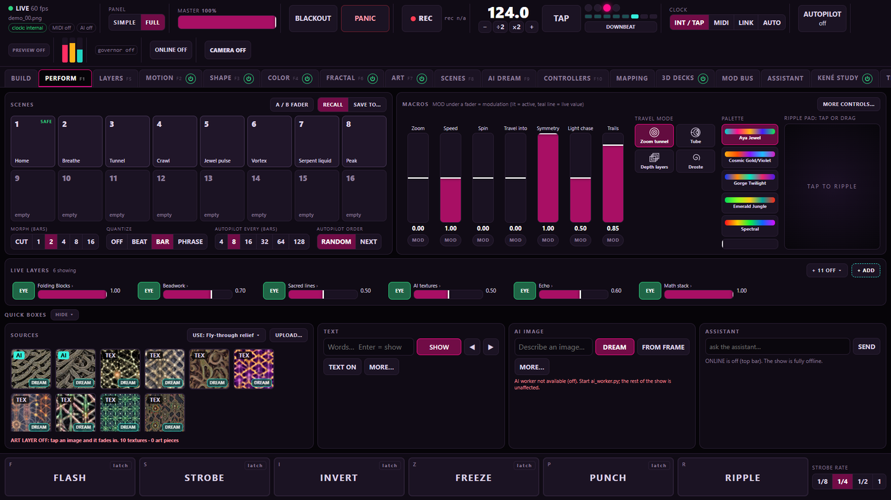
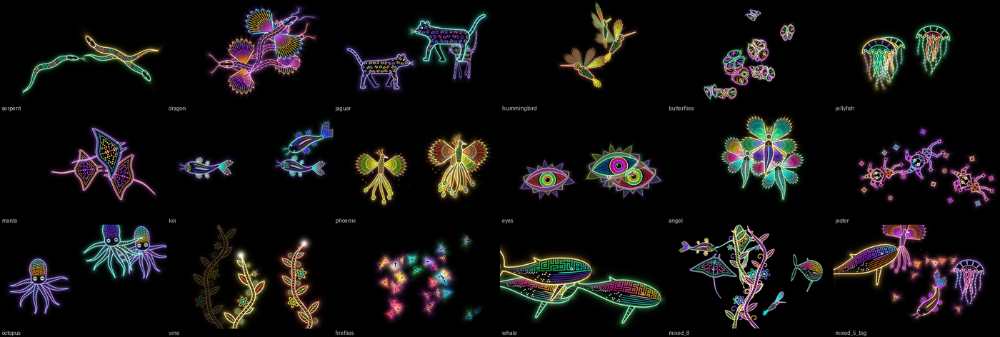
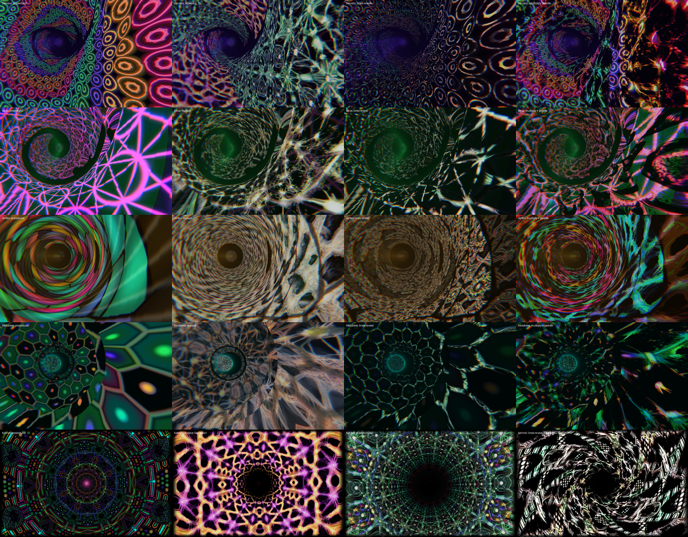
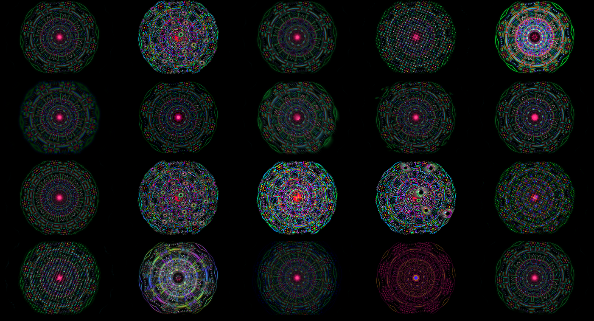
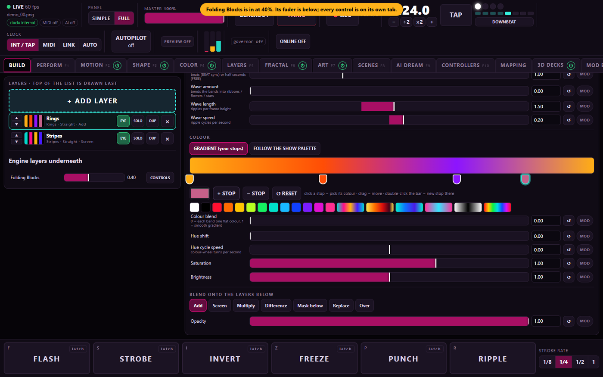

# EntheoControl

A live, audio-reactive visual engine for psychedelic projection mapping. It runs on a modest laptop GPU, puts its picture on a projector, and is played from one browser panel on the laptop, a phone or a tablet.

The visual language draws on visionary art and live VJ work: crawling line labyrinths, swimming beadwork, light chases, tunnels you fly into, luminous creatures, pure-math fractals, and your own artwork turned into 3D relief. Black means no light, so the picture lives on your objects and not on the wall behind them.

It was built for and tested on a 4 GB GTX 1650 Ti laptop driving a 1280 x 800 short-throw projector.



## What it can do

### Visuals
- **Folding Blocks**: the signature generative labyrinth line field, as a flat crawling field or an N-fold mandala. Plus beadwork medallions, sacred-geometry lines, AI textures, video loops and an echo / trails stage.
- **Travel**: fly into the picture as a zoom tunnel, a 3D tube or ground plane, parallax depth layers or a Droste spiral, with spin and corkscrew.
- **Contortions**: swim, twirl, bulge, wave, ripples and a beat-synced light chase.
- **Beings**: 17 generated living and supernatural forms (anaconda spirit, feathered dragon, jaguar spirit, jellyfish, all-seeing eyes, whale, kittens and more), plus segmented serpents. Both have colour modes.
- **Math fractals**: KIFS, Mandelbox, hyperbolic tiling, Apollonian, Julia and a 4D polytope.
- **3D decks**: four raymarched worlds on an A / B deck with blend modes, and a particle swarm.
- **Art fly-through**: upload a painting or photo. It gets a depth map and can become a relief you fly around, a stencil, a kaleidoscope, tunnel walls, a displacement or a melt.
- **Skins**: put any image on the walls of the 3D worlds and the travel tunnel.
- **Text**: words in any installed font, with movement and eight ways to weave them into the picture.
- **Filters**: a six-slot post-FX chain (deep dream, oil paint, halftone, neon edges, prism split, posterize, pixel sort, glitch, bloom, mirror / kaleido).
- **BUILD**: start from a black canvas and stack up to eight stripe, ring, spiral and wave layers by hand.
- **Kené and bead studies**: two generative study layers of the visual grammar of Shipibo-Konibo kené and Huni Kuin beadwork, off by default (see [Respect](#respect-and-rights)).

| Beings | Skins on the 3D worlds | Filters |
|---|---|---|
|  |  |  |

### Performing
- Every control is a fader generated from one parameter registry (`params.py`), so new features show up in the panel by themselves.
- A **MOD** button on every fader: follow bass, mids or highs, beat-synced LFOs, random, a 16-step sequencer or the crowd camera.
- Clock from tap tempo, MIDI clock or Ableton Link.
- 16 scenes with quantized morphs, a scene crossfader, an autopilot and a SAFE scene for PANIC.
- Momentary triggers: flash, strobe, invert, freeze, punch, ripple, blackout.
- MIDI learn, with ready-made maps for the Akai APC mini mk2 and Novation Launch Control XL, a cue channel for Ableton, and gamepad flying.
- **Power buttons** on every tab and layer: off and on again gives back exactly the same settings.

### Mapping
- Several surfaces (box faces, sculpture facets), each a corner-pinned or masked piece of the picture, black everywhere else.
- Angle and edge readouts, SQUARE IT UP, snapping, a pixel magnifier, undo / redo.
- Per surface: whole frame, a spanned picture across all faces, edge glow, soft edge, brightness.
- **AUTO MAP**: let a webcam (a USB one, or the laptop's own) calibrate the projector and find the box faces for you.

### Camera and interactivity
- The **crowd camera** turns dancers into part of the picture: silhouettes, motion trails, flow push, hand ripples, beings that follow hands, a serpent on a raised arm.
- Crowd motion, hand height and hip sway become modulation sources for any fader.
- Analysed locally in memory, never saved or sent, off by default.

### Recording and shows
- **Shows**: save the whole project (look, scenes, timelines, settings, MIDI map, mapping) and reopen it. Includes backups, autosave, crash recovery and `.entheo` export / import.
- **Presets**: save smaller pieces (a look, one layer, the effects chain, a mod routing, a mapping, a MIDI map) and recall all of a preset or only some of its groups.
- **Timeline**: automation lanes, cues, triggers, events and text in bars or seconds. You can also record what you play.
- **Recording**: MP4 of the clean program or the mapped projector output, with laptop audio or the mic, plus a replay buffer.

### Safety and power
- **PANIC** (hold 0.5 s) jumps to the SAFE scene and clears every trigger.
- **Flash guard**: an always-on photosensitive limiter that holds any source, including your own strobe, to at most 3 flashes per second over a quarter of the picture.
- A **brightness limiter**, a **resource governor** that lowers costs step by step when the laptop is strained and puts them back afterwards, and **power balance** profiles that keep the battery from draining on a weak charger during a long show.
- A crash watchdog restarts the show within a second with the same look.

### AI and online
- **Local AI (optional)**: SD-Turbo makes textures from a prompt in about 2.5 s on a 4 GB card, can dream from the current frame, and makes depth maps for uploaded art. **Dreamify** runs a real DeepDream on any image in the library.
- **Online (off by default)**: an assistant that adjusts the show from plain-language requests through a validated, photosensitive-safe command list, and Gemini image generation with your own key. Optionally (a separate opt-in, off by default) the `agy` CLI can serve as a second assistant and as a Nano Banana image / AUTO MAP vision provider. Nothing touches the internet while ONLINE is off.

## Install (Windows 10 / 11)

You need Python 3.11, a recent NVIDIA driver, and a projector set to **Extend** the desktop.

```powershell
cd C:\path\to\EntheoControl
python -m venv .venv
# for the local AI features: install CUDA torch + torchvision from https://pytorch.org first
.\.venv\Scripts\pip.exe install -r requirements.txt
```

Every optional package in `requirements.txt` (AI, camera, Spout, Ableton Link, online) can be left out: the feature that needs it reports itself as unavailable and the rest of the show runs.

## Quick start

```powershell
powershell -ExecutionPolicy Bypass -File run_show.ps1
```

This opens the visuals on monitor 1 (the projector), opens the control panel in your browser, and starts the local AI worker. Play music on the laptop and the picture reacts. Quit with **Shift+Esc**.

- Start from a clean black canvas instead: `run_show.ps1 --monitor 1 --panel --fresh`
- No projector yet? `.\.venv\Scripts\python.exe live_visuals.py` opens a preview window.
- Check that everything renders without a projector: `.\.venv\Scripts\python.exe live_visuals.py --test 90`
- Run the tests: `.\.venv\Scripts\python.exe -m pytest -q`

## Documentation

| Read this | When |
|---|---|
| [WALKTHROUGH.md](WALKTHROUGH.md) | Your first hour, step by step, ending with a recorded mini-show |
| [QUICKSTART.md](QUICKSTART.md) | The reference manual: setup, every tab, every flag, troubleshooting, file locations, glossary |
| [docs/SHOW_DAY_CHECKLIST.md](docs/SHOW_DAY_CHECKLIST.md) | One printable page for a real performance |
| [docs/ARCHITECTURE.md](docs/ARCHITECTURE.md) | For developers: modules, threads, render pipeline, how to add a layer |
| [THIRD_PARTY_NOTICES.md](THIRD_PARTY_NOTICES.md) | Licenses of adapted code, packages and AI models |



## Respect and rights

**Folding Blocks is not kené.** The labyrinth line field (internal name `l_kene`, kept for MIDI and saved shows) is an original generative pattern. It is not a copy of any design and must not be presented as Indigenous art.

**The two study layers** ("Kené study (Shipibo-Konibo inspired)" and "Bead study (Huni Kuin inspired)") are generative studies of a visual grammar documented in [research/kene_reference/README.md](research/kene_reference/README.md). They copy no artwork and must never be labelled as authentic kené. Peru declared Shipibo-Konibo kené national cultural heritage in 2008. The panel carries this credit, and we ask that you carry it too:

> Generative study inspired by Shipibo-Konibo kené / Huni Kuin kenê kuin. For public shows, credit and collaborate with the originating communities. See research/kene_reference.

For public shows, credit these traditions and, where you can, collaborate with or commission artists from the originating communities (the reference README lists who to ask). The Huni Kuin motif geometry has not yet been checked by anyone from the community.

Upload only artwork you made, have licensed, or that is in the public domain. Living visionary artists inspired this project. Their work is not included and should not be used for training or projection without permission.

## Licenses and models

- **Adapted shader code** (Inigo Quilez's distance functions, smooth minimum and Voronoi; David Hoskins' "Hash without Sine") is MIT-licensed. The notices are in [THIRD_PARTY_NOTICES.md](THIRD_PARTY_NOTICES.md) and in the source files.
- **No model weights are included.** The optional features download them on first use, under their own licenses ([models.md](models.md) lists the files):
  - SD-Turbo: **Stability AI Community License**. Free for research and non-commercial use. **Commercial use, such as a paid show, requires registering at https://stability.ai/community-license** and is limited to organisations under USD 1M annual revenue. Powered by Stability AI.
  - Stable Diffusion 1.5 and LCM-LoRA (`--base sd15-lcm`): CreativeML OpenRAIL-M / OpenRAIL++-M.
  - TAESD: MIT. Depth Anything V2 Small: Apache-2.0. MediaPipe selfie segmenter and pose landmarker: Apache-2.0.
  - torchvision GoogLeNet (Dreamify): torchvision notes that pre-trained weights can carry terms from their training data (ImageNet).
- **Python packages** and their licenses: [THIRD_PARTY_NOTICES.md](THIRD_PARTY_NOTICES.md). The optional Ableton Link package `aalink` is GPL-3.0-or-later.

## License

Copyright (C) 2026 SolshineCode and the EntheoControl contributors. [AGPL-3.0](LICENSE).

If you distribute a modified version, or let people use one over a network, you must make its source available (AGPL section 13). The control panel is served over the network, so its **?** help sheet carries a "Source code" link to this repository. If you run a modified version, point that link at your own source.
